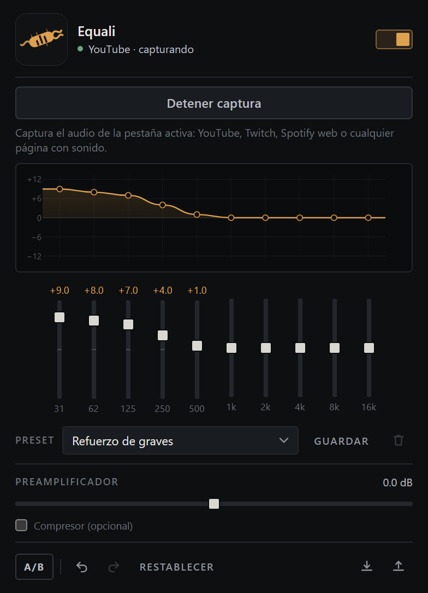

<p align="center">
  
</p>

# Equali · extensión de Chrome

Ecualizador de 10 bandas en tiempo real para **cualquier pestaña de Chrome** con audio:
YouTube, Twitch, Spotify web, Netflix (limitado por DRM), radios online, etc.

Manifest V3, sin dependencias en runtime, sin permisos de red y sin telemetría.

[Repositorio](https://github.com/tnetis/equali) · [Privacidad](PRIVACY.md) · [Licencia](LICENSE)

   

<p align="center">
  
</p>

## Funciones

- **10 bandas** (31 Hz → 16 kHz), ±12 dB, filtros *peaking* con Q 1.1.
- **39 presets** agrupados: Graves, Música, Cine y juegos, Voz, Especiales
  (Bass Booster Xtreme, Party, Club, Cine, Gaming, Podcast, Lo-fi…).
- **Preamplificador** ±12 dB y **protección de salida** fija a −1 dBFS (el compresor
  está desactivado por defecto; el recorte de seguridad no).
- **Curva editable**: arrastra los puntos, doble clic para poner una banda a 0,
  flechas del teclado para ajuste fino, `Shift` para imantar al centro.
- **Espectro en vivo** dibujado detrás de la curva.
- **A/B**: mantén pulsado para escuchar el audio original sin perder el ajuste.
- **Deshacer / rehacer** de la curva (`Ctrl+Z` / `Ctrl+Shift+Z`).
- **Presets propios**: guardar, borrar, exportar e importar en JSON.
- Se aplica a la pestaña que elijas, no a todo el navegador, y **sigue sonando con
  el popup cerrado** (documento *offscreen*).

## Instalar (sin compilar)

1. Abre `chrome://extensions`.
2. Activa **Modo de desarrollador**.
3. **Cargar descomprimida** → elige la carpeta `src/`.
4. Fija la extensión y dale al icono.

> `src/` ya es una extensión válida. `dist/` solo existe para la versión minificada.

## Usar

1. Abre YouTube (o cualquier pestaña con sonido) y dale play.
2. Pulsa el icono de la extensión → **Activar en esta pestaña**.
3. Elige un preset y ajusta. El audio pasa por el ecualizador al instante.

Si el botón dice **Mover aquí**, ya hay otra pestaña capturada: al pulsar se mueve.

## Compilar

```bash
npm install
npm run build   # -> dist/ minificado y con la versión sincronizada
```

Solo se necesita Node 20+. No hay toolchain nativa.

## Pruebas manuales

Con el repo servido en local (`python -m http.server 8771`):

- `tools/harness.html` carga la UI con las APIs de Chrome simuladas.
- `tools/audio-graph-test.html` usa un `MediaStream` real y comprueba que A/B, el
  compresor y el medidor no reconstruyen el grafo de audio.

## GitHub Actions

`.github/workflows/build.yml` se ejecuta en cada push, PR, tag o manualmente:

1. Instala Node 20 y las dependencias (`esbuild`, binario precompilado).
2. Ejecuta `npm run build`.
3. Valida el manifiesto y que existan iconos, service worker y offscreen.
4. Genera `equali-<ref>.zip` y sube dos artefactos:
   `equali-unpacked` (carpeta) y `equali-zip`.
5. Si el push es un tag `v*`, publica un **Release** con el zip adjunto.

Para publicar una versión:

```bash
git tag v1.0.0
git push origin v1.0.0
```

## Arquitectura

```
popup.html/js/css   UI, curva, presets, historial
background.js       service worker: sesión de captura y puente de mensajes
offscreen.html/js   AudioContext real: preamp -> 10 biquads -> limitador -> salida
eq-engine.js        bandas, presets y normalización (compartido)
```

Flujo: el popup pide un `streamId` con `tabCapture` y lo envía al service worker,
que crea el documento *offscreen*. Ahí se abre el `getUserMedia` de la pestaña y se
reproduce por el `AudioContext`, porque Chrome **mueve** el audio al capturarlo.

## Desarrollo

`tools/harness.html` monta el popup con un `chrome.*` simulado para comprobar que
los tres módulos cargan y que la UI responde sin abrir Chrome con la extensión.
`tools/preview.html` hace lo mismo pero sin los estilos de prueba, para revisar el
aspecto real del popup (de ahí sale `assets/equali-preview.png`).

La marca está en `assets/logo.svg`; los PNG de `src/icons/` se generan desde ahí.

```bash
npx serve .          # o cualquier servidor estático en la raíz
# http://localhost:3000/tools/harness.html
```

## Compatibilidad

| Navegador | Soporte | Notas |
|---|---|---|
| Chrome / Edge | ✅ 116+ | Referencia |
| **Brave** | ✅ | Chromium; mismas APIs (`tabCapture`, `offscreen`) |
| **Helium** | ✅ | Chromium; carga descomprimida igual |
| Opera / Vivaldi | ✅ | Chromium 116+ |
| Firefox / Safari | ❌ | No tienen `tabCapture` + documentos offscreen |

Si el navegador es demasiado antiguo, la extensión lo dice al activar la captura en
lugar de fallar en silencio.

## Seguridad de oído y altavoces

El nivel de salida está acotado por hardware de audio, no por buena voluntad:

- **Soft-clip siempre activo** (`WaveShaper` con saturación suave): ninguna muestra
  pasa de 0 dBFS aunque pongas preamp +12 dB y diez bandas a +12 dB. Por debajo de
  −6 dBFS es transparente (ganancia unidad), así que no colorea el sonido normal.
- **Techo maestro fijo a −1 dBFS** (0.89). No se puede desactivar desde la interfaz.
- **Rampas de 30 ms** en cada cambio de ganancia y preamp: sin clics.
- **Fade-in de 250 ms** al activar y **fade-out de 70 ms** al detener: sin golpes
  en los altavoces al empezar o cortar.
- El compresor (checkbox) es opcional y viene desactivado; la protección de arriba, no.

Aun así, el sentido común manda: empieza con el volumen del sistema bajo y sube
desde ahí. La extensión no puede proteger un volumen que ya viene saturado.

## Rendimiento

- **0 % de CPU en reposo**: si no hay sonido no se envía ni se pinta nada.
- El **espectro solo existe con el popup abierto**; al cerrarlo se deja de leer el
  analizador (no hay FFT), pero el nodo sigue conectado para no cortar el audio.
- **Grafo fijo**: A/B, encendido y compresor no reconstruyen la cadena; solo cambian
  ganancias con rampas cortas, sin clics ni cortes.
- Medidor a **10 fps**, sin asignaciones en el bucle caliente.
- Movimientos de slider: **1 escritura en disco por gesto** (antes ~11) y mensajes
  agrupados a ~16/s.
- Sin `setInterval` en el popup: se repinta bajo demanda, máximo ~18 fps.

## Limitaciones

- Solo **una pestaña a la vez** (restricción de `tabCapture`).
- No ecualiza aplicaciones nativas de Windows, solo pestañas de Chrome.
- Audio protegido con DRM (Netflix, algunas radios) puede llegar en silencio.
- `tabCapture` añade latencia (del orden de 100–200 ms): en vídeo, la imagen puede
  ir ligeramente por delante del sonido. Es una limitación de la API de Chrome.
- La salida se reproduce en el dispositivo de audio predeterminado del sistema.
- Páginas `chrome://`, la Web Store y otras extensiones no se pueden capturar.
- Al recargar la extensión hay que volver a activar la captura.

## Privacidad

No hay llamadas de red, ni analítica, ni cuentas. Los ajustes viven en
`chrome.storage.local` y el audio se procesa en memoria, nunca se graba.
Política completa: [PRIVACY.md](PRIVACY.md).

## Licencia

MIT © 2026 Equali contributors. Ver [LICENSE](LICENSE).
